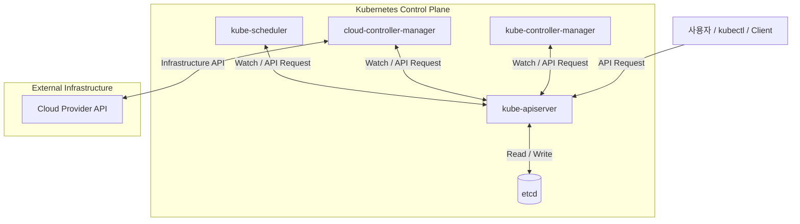
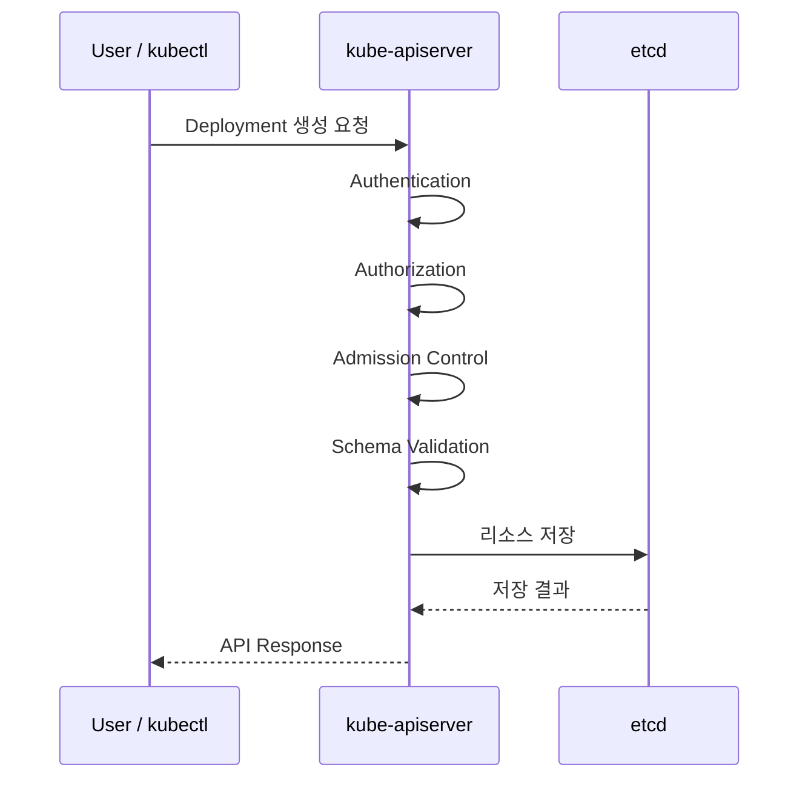
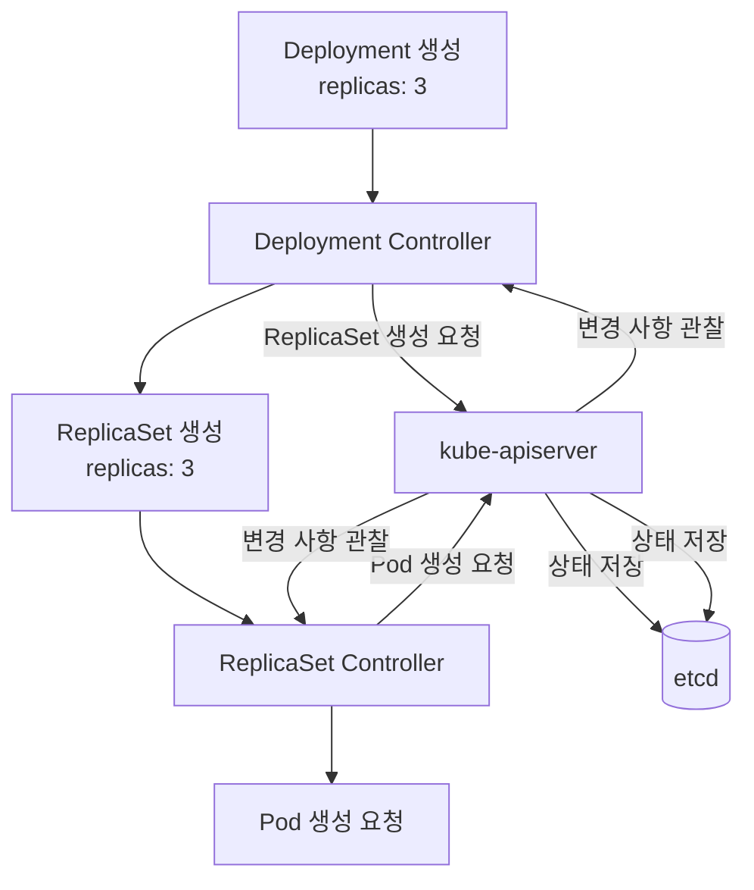
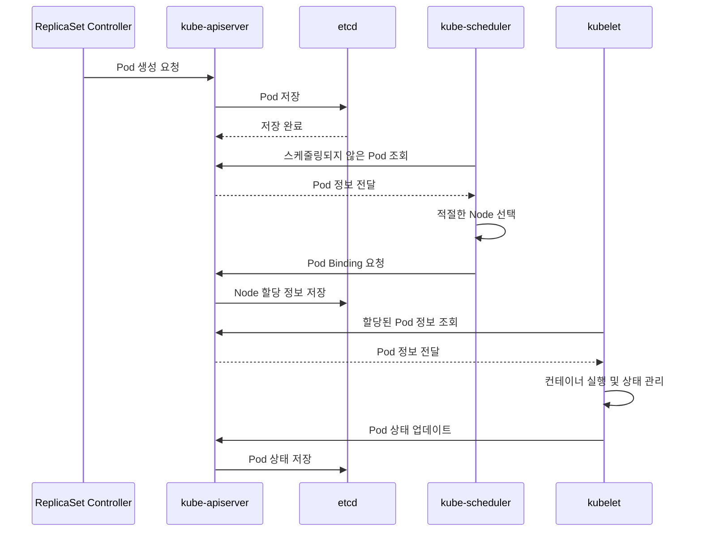
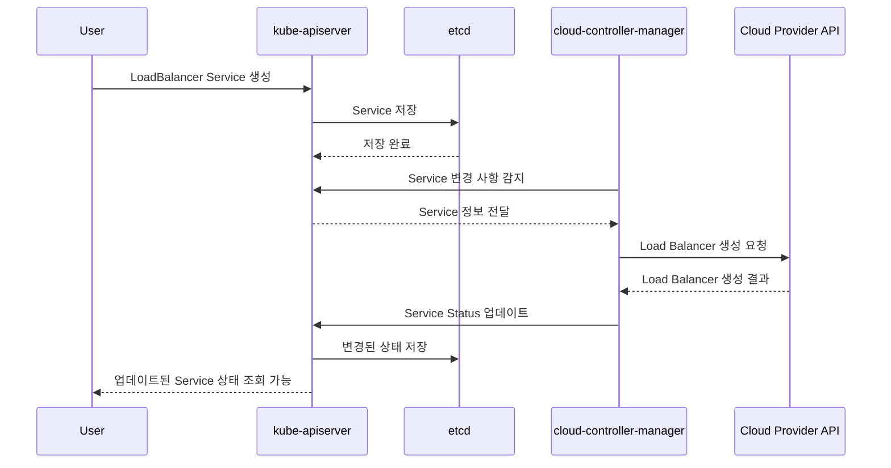

# Kubernetes Control Plane 전체 구조와 데이터 흐름

## 1. Control Plane이란?

Kubernetes Control Plane은 클러스터의 전체 상태를 관리하고, 사용자가 선언한 Desired State(원하는 상태)가 실제 클러스터에 반영되도록 조정하는 구성 요소들의 집합입니다.

사용자가 Kubernetes API를 통해 리소스를 생성하거나 변경하면 Control Plane은 해당 요청을 처리하고, 저장된 상태를 기반으로 클러스터의 현재 상태를 원하는 상태에 맞춰 조정합니다.

Control Plane은 여러 컴포넌트가 역할을 분담하는 구조로 설계되어 있습니다.

| 컴포넌트 | 주요 책임 |
|---|---|
| kube-apiserver | Kubernetes API 제공 및 요청 처리 |
| etcd | 클러스터 상태 데이터의 영속적 저장 |
| kube-controller-manager | Kubernetes 내부 리소스의 상태 조정 |
| cloud-controller-manager | 클라우드 인프라와 Kubernetes 리소스의 상태 조정 |
| kube-scheduler | 스케줄링되지 않은 Pod의 실행 노드 결정 |

이 문서에서는 `kube-apiserver`, `etcd`, `kube-controller-manager`, `cloud-controller-manager`를 중심으로 Control Plane의 데이터 흐름과 각 컴포넌트의 책임 경계를 살펴봅니다. `kube-scheduler`는 전체 흐름을 이해하기 위한 연관 컴포넌트로 함께 설명합니다.

## 2. Control Plane 전체 구조

Control Plane의 각 컴포넌트는 독립적인 책임을 가지고 있지만, Kubernetes API를 중심으로 상호작용합니다.

특히 `kube-apiserver`는 컴포넌트 간의 공통 인터페이스 역할을 수행합니다. 대부분의 Control Plane 컴포넌트는 API Server를 통해 클러스터 상태를 조회하거나 변경하며, API Server는 요청을 처리한 뒤 etcd에 상태를 저장합니다.



위 구조에서 각 컴포넌트의 책임은 다음과 같이 구분됩니다.

- **kube-apiserver:** Kubernetes API 요청을 수신하고 처리하는 공통 진입점입니다.
- **etcd:** API Server가 관리하는 Kubernetes 리소스의 영속적 상태를 저장합니다.
- **kube-controller-manager:** Kubernetes 내부 리소스의 Desired State와 Current State를 비교하고 조정합니다.
- **cloud-controller-manager:** 클라우드 인프라의 상태를 확인하고 Kubernetes 리소스와 클라우드 리소스 간의 일관성을 유지합니다.
- **kube-scheduler:** 실행 노드가 지정되지 않은 Pod를 감지하고 적절한 Node를 선택합니다.

이러한 구조에서는 각 컴포넌트가 서로의 내부 구현에 직접 의존하기보다 Kubernetes API를 통해 상태를 공유하고 협력합니다.

## 3. 컴포넌트별 책임과 경계

### 3.1. kube-apiserver: API 요청 처리와 상태 관리의 중심

`kube-apiserver`는 Kubernetes API를 외부에 제공하는 Control Plane의 핵심 컴포넌트입니다.

사용자뿐만 아니라 Controller, Scheduler, kubelet 등 Kubernetes의 다른 컴포넌트도 API Server를 통해 클러스터 상태를 조회하거나 변경합니다.

주요 책임은 다음과 같습니다.

- Kubernetes API 요청 수신 및 처리
- Authentication을 통한 요청 사용자 확인
- Authorization을 통한 요청 권한 확인
- Admission Control을 통한 리소스 생성 및 변경 요청 검증과 조정
- API Object의 Schema Validation
- etcd를 이용한 리소스 상태의 저장 및 조회
- List/Watch API 제공

API Server는 Kubernetes 리소스에 대한 접근을 통제하는 공통 인터페이스입니다.

다른 컴포넌트는 일반적으로 etcd에 직접 접근하지 않고 API Server를 통해 리소스 상태를 조회하거나 변경합니다.

따라서 API Server는 단순한 HTTP API 서버가 아니라 Kubernetes의 상태 관리와 컴포넌트 간 통신을 연결하는 핵심 경계입니다.

### 3.2. etcd: 클러스터 상태의 영속적 저장소

`etcd`는 Kubernetes 클러스터의 상태 데이터를 저장하는 분산 Key-Value 저장소입니다.

API Server는 Kubernetes 리소스를 생성하거나 변경할 때 etcd에 해당 상태를 저장하며, 리소스를 조회할 때도 etcd에 저장된 데이터를 기반으로 처리합니다.

주요 책임은 다음과 같습니다.

- Kubernetes 리소스 데이터의 영속적 저장
- Key-Value 기반 데이터 관리
- MVCC를 통한 데이터 버전 관리
- Raft 합의 알고리즘을 통한 클러스터 간 데이터 일관성 유지
- Watch를 통한 데이터 변경 감지

etcd는 Kubernetes 리소스의 상태를 저장하지만, 리소스의 Desired State를 실제 상태로 조정하는 역할은 수행하지 않습니다.

예를 들어 Deployment의 `replicas: 3`이라는 설정을 저장하는 것은 etcd의 역할이지만, 실제 Pod가 3개 실행되도록 조정하는 것은 Controller의 역할입니다.

또한 etcd는 Kubernetes API를 직접 제공하는 컴포넌트가 아닙니다. Kubernetes API를 통한 접근과 요청 처리는 API Server가 담당합니다.

### 3.3. kube-controller-manager: Kubernetes 내부 상태 조정

`kube-controller-manager`는 Kubernetes의 Built-in Controller를 실행하는 컴포넌트입니다.

각 Controller는 특정 리소스의 상태를 감시하고 Desired State와 Current State 사이의 차이를 확인하여 필요한 조치를 수행합니다.

주요 책임은 다음과 같습니다.

- Deployment, ReplicaSet, StatefulSet 등 Workload 리소스 조정
- Node 상태 감시 및 장애 대응
- Job과 CronJob의 실행 상태 관리
- Namespace 및 ServiceAccount 관리
- Service와 EndpointSlice 간의 관계 관리
- Kubernetes 내부 리소스의 Reconciliation 수행

예를 들어 Deployment의 Desired State가 3개의 Pod를 실행하는 것이라면 Deployment Controller와 ReplicaSet Controller가 협력하여 해당 상태를 유지합니다.

이 과정에서 Controller는 Pod를 직접 실행하지 않습니다. 필요한 Pod 리소스를 API Server에 요청하고, 이후 Scheduler와 kubelet 등의 다른 컴포넌트가 실제 실행 과정을 담당합니다.

따라서 `kube-controller-manager`의 핵심 책임은 리소스의 실행 자체가 아니라 Kubernetes API에 선언된 상태를 지속적으로 조정하는 것입니다.

### 3.4. cloud-controller-manager: 클라우드 인프라 상태 조정

`cloud-controller-manager`는 클라우드 제공자별 제어 로직을 Kubernetes의 핵심 제어 로직과 분리한 컴포넌트입니다.

Kubernetes 내부 리소스만으로 처리할 수 없는 클라우드 인프라 관련 작업을 수행하며, Cloud Provider API와 Kubernetes API를 함께 사용합니다.

주요 책임은 다음과 같습니다.

- Cloud Node Controller를 통한 Node와 클라우드 인스턴스 정보 연동
- Route Controller를 통한 클라우드 네트워크 라우팅 관리
- Service Controller를 통한 클라우드 Load Balancer 관리

예를 들어 사용자가 `type: LoadBalancer`인 Service를 생성하면 Service Controller는 이를 감지하고 Cloud Provider API를 통해 Load Balancer를 생성하거나 변경합니다.

클라우드 인프라에서 확인한 결과는 Kubernetes API를 통해 Service 등의 리소스 상태에 반영됩니다.

`cloud-controller-manager`는 클라우드 제공자별 구현을 분리하여 Kubernetes의 핵심 컴포넌트가 특정 클라우드 플랫폼에 종속되지 않도록 지원합니다.

단, 클라우드 인프라를 사용하지 않는 환경에서는 해당 컴포넌트가 필요하지 않을 수 있습니다.

## 4. Control Plane의 주요 데이터 흐름

Control Plane의 동작을 이해하려면 사용자의 API 요청이 어떻게 저장되고, 저장된 상태를 기반으로 각 Controller가 어떤 작업을 수행하는지 살펴볼 필요가 있습니다.

### 4.1. 사용자의 리소스 생성 요청

사용자가 다음과 같은 Deployment를 생성한다고 가정합니다.

```yaml
apiVersion: apps/v1
kind: Deployment
metadata:
  name: nginx
spec:
  replicas: 3
  selector:
    matchLabels:
      app: nginx
  template:
    metadata:
      labels:
        app: nginx
    spec:
      containers:
        - name: nginx
          image: nginx:latest
```

사용자가 `kubectl apply` 명령을 실행하면 다음과 같은 흐름으로 처리됩니다.



요청 처리 과정은 다음과 같습니다.

1. 사용자가 API Server에 Deployment 생성 요청을 전달합니다.
2. API Server는 요청 사용자를 인증하고 해당 요청의 권한을 확인합니다.
3. Admission Control을 통해 정책 검증 및 요청 변경 작업을 수행할 수 있습니다.
4. API Server는 리소스의 유효성을 검증합니다.
5. 검증을 통과한 리소스는 etcd에 저장됩니다.
6. API Server는 요청 처리 결과를 사용자에게 반환합니다.

이 시점에서 Deployment 리소스는 Kubernetes API에 등록되어 있지만, 요청한 개수만큼의 Pod가 실제로 실행되고 있다는 의미는 아닙니다.

리소스 생성 이후에는 Controller와 Scheduler 등의 컴포넌트가 각자의 책임에 따라 후속 작업을 수행합니다.

### 4.2. kube-controller-manager의 Reconciliation

Deployment가 etcd에 저장되면 API Server를 통해 해당 리소스의 변경 사항을 관찰하는 Controller가 이를 감지합니다.

Deployment Controller는 Deployment의 Desired State를 확인하고, 필요한 경우 ReplicaSet을 생성하거나 변경합니다.

이후 ReplicaSet Controller가 ReplicaSet의 설정을 확인하고 필요한 Pod를 생성합니다.



실제 동작에서는 Controller가 API Server의 List/Watch 및 로컬 캐시를 활용하여 리소스 변경을 감지합니다. 필요한 작업은 Work Queue 등을 통해 처리할 수 있습니다.

중요한 점은 Controller가 etcd에 직접 접근하지 않는다는 것입니다.

Controller는 API Server를 통해 리소스 상태를 조회하고 변경 요청을 전달합니다. API Server가 해당 변경을 검증하고 etcd에 반영합니다.

또한 Deployment Controller와 ReplicaSet Controller는 서로 다른 책임을 수행합니다.

- Deployment Controller는 Deployment의 Desired State에 맞게 ReplicaSet을 관리합니다.
- ReplicaSet Controller는 ReplicaSet의 Desired State에 맞게 Pod를 관리합니다.

이처럼 Kubernetes는 여러 Controller가 각자의 책임 범위에서 연속적으로 상태를 조정하는 구조입니다.

### 4.3. kube-scheduler와 kubelet의 연계

ReplicaSet Controller가 Pod를 생성하면 해당 Pod는 API Server를 통해 클러스터에 등록됩니다.

하지만 Pod 생성 요청에는 실행할 Node가 아직 지정되지 않았을 수 있습니다.

이 경우 kube-scheduler가 스케줄링되지 않은 Pod를 감지하고 적절한 Node를 선택합니다.

Scheduler는 선택한 Node를 Pod의 `spec.nodeName`에 반영하도록 API Server에 요청합니다.

이후 해당 Node의 kubelet이 Pod 할당 정보를 확인하고 컨테이너를 실행합니다.



이 과정에서 각 컴포넌트의 책임은 다음과 같이 구분됩니다.

| 컴포넌트 | 책임 |
|---|---|
| ReplicaSet Controller | 필요한 Pod 리소스 생성 |
| kube-apiserver | Pod 생성 및 상태 변경 요청 처리 |
| etcd | Pod 상태 데이터 저장 |
| kube-scheduler | Pod가 실행될 Node 선택 |
| kubelet | 할당된 Pod의 컨테이너 실행 및 상태 관리 |

따라서 Controller가 Pod 리소스를 생성하는 것과 실제 컨테이너가 실행되는 것은 서로 다른 단계입니다.

### 4.4. cloud-controller-manager의 클라우드 인프라 연동

클라우드 환경에서는 Kubernetes 리소스의 상태를 실제 클라우드 인프라와 동기화해야 하는 경우가 있습니다.

대표적인 예가 `type: LoadBalancer`인 Service입니다.

사용자가 LoadBalancer Service를 생성하면 Service Controller가 해당 변경을 감지하고 Cloud Provider API를 호출합니다.



이 과정에서 `cloud-controller-manager`는 Kubernetes API와 Cloud Provider API를 모두 사용합니다.

- Kubernetes API를 통해 Service의 Desired State를 확인합니다.
- Cloud Provider API를 통해 실제 Load Balancer를 생성하거나 변경합니다.
- 작업 결과를 Kubernetes API에 반영합니다.

이처럼 Kubernetes 내부 상태와 외부 인프라 상태를 연결하는 것이 `cloud-controller-manager`의 핵심 역할입니다.

다만 실제 Load Balancer의 트래픽 전달 경로는 클라우드 제공자, Load Balancer 유형, CNI 및 데이터 플레인 구현에 따라 달라질 수 있습니다.

## 5. Control Plane의 핵심 상호작용 패턴

앞서 살펴본 흐름을 통해 Control Plane의 컴포넌트들이 공통적으로 사용하는 상호작용 패턴을 정리할 수 있습니다.

### 5.1. API Server 중심의 상태 접근

Kubernetes의 주요 컴포넌트는 API Server를 통해 리소스 상태를 조회하거나 변경합니다.

예를 들어 Controller가 Deployment를 조회하고 ReplicaSet을 생성하거나, Scheduler가 Pod에 Node를 할당하는 과정은 모두 API Server를 통해 이루어집니다.

이 구조는 컴포넌트 간의 직접적인 의존성을 줄이고, Kubernetes API를 중심으로 일관된 상태 관리가 가능하도록 합니다.

### 5.2. Watch 기반 변경 감지

Controller와 Scheduler 등의 컴포넌트는 API Server의 List/Watch API를 사용하여 리소스 변경 사항을 감지할 수 있습니다.

일반적인 동작 방식은 다음과 같습니다.

1. List 요청으로 현재 리소스 상태를 조회합니다.
2. Watch 요청을 통해 이후 발생하는 변경 사항을 감지합니다.
3. 변경된 리소스를 로컬 캐시에 반영합니다.
4. 필요한 작업을 Work Queue에 등록합니다.
5. 작업을 처리하고 필요한 API 요청을 수행합니다.

이 방식은 컴포넌트가 일정한 간격으로 모든 리소스를 반복 조회하는 부담을 줄이고, 변경 사항에 빠르게 대응할 수 있도록 지원합니다.

단, Watch 이벤트 자체가 모든 조정 작업의 완료를 보장하는 것은 아닙니다. Controller는 현재 상태를 다시 확인하고 필요한 조치를 수행하는 Reconciliation 구조를 사용합니다.

### 5.3. Reconciliation Loop

Kubernetes는 Desired State와 Current State의 차이를 지속적으로 조정하는 Control Loop 기반으로 동작합니다.

일반적인 Reconciliation 과정은 다음과 같습니다.

1. API Server를 통해 현재 리소스 상태를 확인합니다.
2. Desired State와 Current State를 비교합니다.
3. 두 상태 사이의 차이를 계산합니다.
4. 차이를 줄이기 위한 작업을 수행합니다.
5. 변경된 상태를 API Server에 반영합니다.
6. 이후에도 상태를 지속적으로 관찰하고 필요한 조정을 반복합니다.

예를 들어 Deployment의 `replicas`가 3으로 설정되어 있지만 실제 Pod가 2개만 존재한다면 ReplicaSet Controller는 부족한 Pod를 생성합니다.

이 과정은 특정 이벤트가 한 번 발생했을 때만 수행되는 것이 아니라, Controller가 실행되는 동안 지속적으로 반복됩니다.

또한 여러 Controller가 각자의 책임 범위에서 독립적으로 Reconciliation을 수행하므로, 특정 Controller가 일시적으로 실패하더라도 다시 실행되면 현재 상태를 확인하고 조정을 이어갈 수 있습니다.

## 6. 컴포넌트 간 책임 경계

Control Plane의 각 컴포넌트는 서로 협력하지만, 책임 범위는 명확하게 구분됩니다.

특히 다음과 같은 차이를 이해하는 것이 중요합니다.

### 6.1. kube-apiserver와 etcd

| 구분 | kube-apiserver | etcd |
|---|---|---|
| 핵심 역할 | Kubernetes API 제공 및 요청 처리 | 상태 데이터 영속적 저장 |
| 요청 처리 | 인증, 인가, Admission Control 등 | Kubernetes API 요청을 직접 처리하지 않음 |
| 데이터 접근 | etcd를 통해 리소스 조회 및 저장 | Key-Value 데이터 저장 및 조회 |
| 상태 변경 | API 요청을 검증하고 저장 작업 수행 | 전달받은 데이터를 저장 |
| 주요 책임 | API 및 상태 접근의 통제 | 데이터의 일관성과 영속성 |

API Server는 Kubernetes 리소스의 접근과 변경을 통제하며, etcd는 API Server가 관리하는 상태 데이터를 저장합니다.

따라서 etcd가 Kubernetes 리소스의 상태를 저장한다고 해서 Kubernetes API의 요청 처리까지 담당하는 것은 아닙니다.

### 6.2. kube-controller-manager와 cloud-controller-manager

| 구분 | kube-controller-manager | cloud-controller-manager |
|---|---|---|
| 핵심 역할 | Kubernetes 내부 상태 조정 | 클라우드 인프라 상태 조정 |
| 주요 대상 | Deployment, ReplicaSet, Node, Job 등 | Cloud Node, Cloud Route, Load Balancer 등 |
| 외부 API 의존성 | 일반적으로 Kubernetes API 중심 | Kubernetes API 및 Cloud Provider API |
| 실행 환경 | Kubernetes Control Plane | 클라우드 연동이 필요한 환경 |
| 주요 목적 | Kubernetes 리소스의 Desired State 유지 | Kubernetes와 클라우드 인프라 간 상태 동기화 |

두 컴포넌트 모두 Controller를 실행하고 Reconciliation을 수행하지만, 조정 대상과 외부 시스템 의존성에서 차이가 있습니다.

특히 Node와 관련된 Controller는 이름이 유사하더라도 책임이 다릅니다.

- **kube-controller-manager의 Node Controller:** Node의 상태를 감시하고 응답이 없는 Node에 대한 장애 대응을 수행합니다.
- **cloud-controller-manager의 Cloud Node Controller:** Cloud Provider API를 통해 클라우드 인스턴스 정보를 확인하고 Kubernetes Node 리소스에 반영합니다.

두 Controller의 동작은 서로 연관될 수 있지만 동일한 기능을 수행하는 것은 아닙니다.

### 6.3. Controller와 Scheduler

| 구분 | Controller | kube-scheduler |
|---|---|---|
| 핵심 역할 | 리소스 상태 조정 | Pod의 실행 Node 선택 |
| 주요 대상 | Deployment, ReplicaSet, Pod 등 | 스케줄링되지 않은 Pod |
| 주요 작업 | 필요한 리소스 생성 및 변경 | Node 적합성 평가 및 Binding |
| 실행 결과 | Desired State에 필요한 리소스 확보 | Pod에 실행 Node 할당 |

Controller는 필요한 Pod 리소스를 생성하지만, 해당 Pod가 실행될 Node를 직접 선택하지는 않습니다.

Scheduler는 생성된 Pod 중 Node가 할당되지 않은 Pod를 대상으로 적절한 Node를 선택합니다.

이후 kubelet이 해당 Node에서 컨테이너를 실행합니다.

따라서 Pod의 생성, 배치, 실행은 서로 다른 컴포넌트가 담당하는 단계적인 과정입니다.

## 7. 장애와 가용성 관점에서의 관계

Control Plane은 여러 컴포넌트가 협력하는 구조이므로 특정 컴포넌트의 장애가 클러스터 전체에 미치는 영향도 서로 다릅니다.

| 컴포넌트 | 장애 발생 시 주요 영향 |
|---|---|
| kube-apiserver | Kubernetes API 요청 처리와 컴포넌트 간 상태 조회 및 변경에 영향 |
| etcd | 클러스터 상태 데이터의 저장 및 조회에 영향 |
| kube-controller-manager | Built-in Controller의 상태 조정 작업에 영향 |
| cloud-controller-manager | 클라우드 인프라 연동 및 관련 리소스 조정에 영향 |
| kube-scheduler | 새로운 Pod의 Node 배치에 영향 |

각 컴포넌트의 장애 영향을 구분하면 다음과 같습니다.

### kube-apiserver 장애

API Server가 사용할 수 없는 상태가 되면 사용자와 다른 컴포넌트는 Kubernetes API를 정상적으로 이용하기 어렵습니다.

Controller의 상태 조회 및 변경, Scheduler의 Pod 할당, kubelet의 API 기반 상태 보고 등에도 영향을 줄 수 있습니다.

여러 API Server 인스턴스를 실행하고 Load Balancer 등을 통해 요청을 분산하면 API Server 인스턴스 장애에 대한 가용성을 높일 수 있습니다.

### etcd 장애

etcd의 Quorum을 확보하지 못하면 클러스터 상태 데이터의 정상적인 읽기 및 쓰기가 제한될 수 있습니다.

API Server가 정상적으로 실행 중이더라도 etcd에 접근할 수 없다면 리소스 상태의 조회와 변경이 정상적으로 처리되지 않을 수 있습니다.

따라서 etcd의 백업, 복구, 클러스터 멤버 관리 및 Quorum 유지는 Control Plane 운영에서 중요한 요소입니다.

### kube-controller-manager 장애

Controller가 중단되면 해당 Controller가 담당하는 리소스의 Reconciliation이 중단됩니다.

예를 들어 ReplicaSet Controller가 중단되면 Pod 개수가 Desired State와 달라져도 이를 자동으로 조정하지 못할 수 있습니다.

다만 이미 실행 중인 Pod의 컨테이너가 즉시 중단되는 것은 아닙니다. 기존 Pod의 실행은 Node의 kubelet과 컨테이너 런타임이 담당하기 때문입니다.

### cloud-controller-manager 장애

Cloud Controller가 중단되면 클라우드 인프라와 Kubernetes 리소스 간의 상태 조정이 지연되거나 중단될 수 있습니다.

예를 들어 LoadBalancer Service를 새로 생성하더라도 실제 클라우드 Load Balancer가 생성되지 않거나, 기존 인프라 변경 사항이 Kubernetes 리소스에 반영되지 않을 수 있습니다.

다만 이미 생성된 클라우드 Load Balancer의 실제 트래픽 처리까지 반드시 즉시 중단되는 것은 아닙니다. 해당 인프라의 데이터 플레인은 Control Plane의 Controller 프로세스와 별도로 동작할 수 있기 때문입니다.

### 고가용성 구성

Kubernetes Control Plane은 환경과 배포 방식에 따라 여러 인스턴스로 구성할 수 있습니다.

- API Server는 여러 인스턴스를 실행하여 수평 확장할 수 있습니다.
- etcd는 Raft 기반의 다중 노드 클러스터로 구성하여 데이터 일관성과 장애 허용성을 확보할 수 있습니다.
- Controller Manager와 Cloud Controller Manager는 여러 인스턴스를 실행하고 Leader Election을 통해 활성 Leader가 조정 작업을 수행하도록 구성할 수 있습니다.

각 컴포넌트의 고가용성 방식은 동일하지 않습니다. 특히 etcd는 Quorum 기반의 분산 합의를 사용하고, Controller Manager 계열은 Leader Election을 통해 활성 인스턴스를 선택하는 방식이라는 차이가 있습니다.

## 8. 정리

Kubernetes Control Plane은 여러 컴포넌트가 각자의 책임을 분담하면서 API Server를 중심으로 협력하는 구조입니다.

각 컴포넌트의 핵심 역할은 다음과 같습니다.

- **kube-apiserver:** Kubernetes API의 진입점으로서 모든 주요 리소스 요청을 처리하고 상태 접근을 통제합니다.
- **etcd:** Kubernetes 클러스터의 상태 데이터를 영속적으로 저장하고 일관성을 유지합니다.
- **kube-controller-manager:** Kubernetes 내부 리소스의 Desired State와 Current State를 지속적으로 조정합니다.
- **cloud-controller-manager:** Cloud Provider API와 연동하여 클라우드 인프라와 Kubernetes 리소스의 상태를 조정합니다.
- **kube-scheduler:** 생성된 Pod가 실행될 적절한 Node를 선택합니다.

전체 흐름은 다음과 같이 요약할 수 있습니다.

1. 사용자는 API Server를 통해 Kubernetes 리소스의 Desired State를 선언합니다.
2. API Server는 요청을 검증하고 etcd에 리소스 상태를 저장합니다.
3. Controller와 Scheduler는 API Server를 통해 리소스 변경 사항을 감지하고 각자의 책임에 따라 작업을 수행합니다.
4. Controller는 필요한 Kubernetes 리소스를 생성하거나 변경하고, Scheduler는 Pod의 실행 Node를 결정합니다.
5. Cloud Controller는 필요한 경우 Cloud Provider API를 호출하여 외부 인프라를 조정합니다.
6. 각 컴포넌트는 변경된 상태를 API Server에 반영하고, API Server는 이를 etcd에 저장합니다.
7. 이러한 과정이 반복되면서 클러스터의 Current State가 Desired State에 가까워집니다.

핵심은 **API Server가 상태 접근과 변경의 중심이며, etcd가 상태를 저장하고, 각 Controller와 Scheduler가 저장된 상태를 기반으로 자신의 책임 범위에서 클러스터를 조정한다는 점**입니다.

이러한 역할 분리를 통해 Kubernetes는 개별 컴포넌트의 구현과 실행을 독립적으로 유지하면서도 전체 클러스터의 상태를 일관된 방향으로 관리할 수 있습니다.

## 9. 참고자료

### Kubernetes 공식 문서

- [Kubernetes - Cluster Architecture](https://kubernetes.io/docs/concepts/architecture/)
- [Kubernetes - Components](https://kubernetes.io/docs/concepts/overview/components/)
- [Kubernetes - Controllers](https://kubernetes.io/docs/concepts/architecture/controller/)
- [Kubernetes - Cloud Controller Manager](https://kubernetes.io/docs/concepts/architecture/cloud-controller/)
- [Kubernetes - Nodes](https://kubernetes.io/docs/concepts/architecture/nodes/)
- [Kubernetes - kube-scheduler](https://kubernetes.io/docs/concepts/scheduling-eviction/kube-scheduler/)

### etcd 공식 문서

- [etcd Documentation](https://etcd.io/docs/)
- [etcd - API Guarantees](https://etcd.io/docs/v3.6/learning/api_guarantees/)
- [etcd - Data Model](https://etcd.io/docs/v3.6/learning/data_model/)